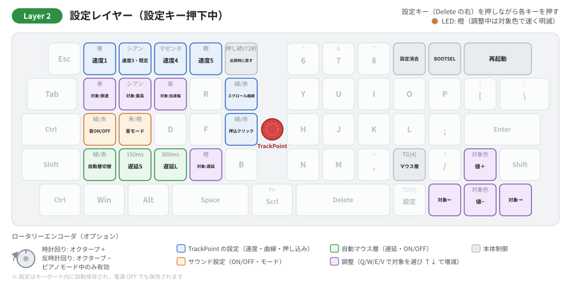

# OLSK60 マウス機能操作マニュアル

このドキュメントは、OLSK60 v2 のトラックポイント速度設定に関する詳細マニュアルです。トラックポイントの速度を自分好みに微調整したい方を対象としています。  
基本操作や他の機能については[キーボード操作ガイド](OLSK60_user_guide.md)をご参照ください。

> **本書が前提とするファームウェア:** **v3.1.0 以降**（Vial 対応・本リポジトリの[最新リリース](https://github.com/techmech-keeb/OLSK60_v2/releases/latest)）です。v3.1.0 でトラックポイントの速度の仕組みと調整項目が変わりました。v3.0.x をお使いの方は [v3.0.2 時点の説明](https://github.com/techmech-keeb/OLSK60_v2/tree/153b580f5554c609e665ec66a5212e8055407039/docs/OLSK60_mouse_manual.md)、旧版（v2.x）をお使いの方は [v2.0.3 時点の説明](https://github.com/techmech-keeb/OLSK60_v2/tree/v2.0.3)をご覧ください。

---

## クイックリファレンス

すべての操作はレイヤー2（最下段の**設定キー**＝ Delete の右を押しながら）で行います。

| キー | 機能 |
|------|------|
| 1 / 2 | 固定プロファイル切替（速度1 / 速度3） |
| 3 / 4 | 調整枠切替（速度4 / 速度5） |
| Q / W / E | 調整する対象を選ぶ（微速の倍率 / 最高倍率 / 加速の幅） |
| V | 調整する対象を選ぶ（オートレイヤーの解除時間） |
| ← / → | 調整する対象を順に切り替える |
| ↑ / ↓ | 選んだ対象の値を上げる / 下げる（微速の倍率・最高倍率・加速の幅は速度4・速度5 のときのみ） |
| Z | オートレイヤー ON/OFF |
| X / C | オートレイヤー解除時間（150ms / 800ms） |
| T | スクロールの効き方（強く操作するほど速い ⇄ 従来どおり） |
| G | 押し込みクリック ON/OFF |
| . | マウスレイヤーの手動 ON/OFF（TG(4)） |
| 5（2 秒押し続ける） | 出荷時の設定に戻す（キー配置はそのまま） |

---

## 目次

1. [トラックポイントの基本操作](#トラックポイントの基本操作)
2. [速度プロファイル](#速度プロファイル)
3. [調整枠の調整](#調整枠の調整)
4. [オートレイヤー](#オートレイヤー)
5. [LEDリファレンス](#ledリファレンス)
6. [設定の保存](#設定の保存)
7. [トラブルシューティング](#トラブルシューティング)

---

## トラックポイントの基本操作

### カーソル移動

トラックポイントを指先で軽く押すことでカーソルを移動できます。押す力の強さに応じてカーソルの移動速度が変化します。

v3.1.0 からは、**カーソルを動かす速さに応じて倍率が変わります。**ゆっくり動かすと小さい倍率で細かく、速く動かすほど大きい倍率で遠くまで動きます。細かい位置合わせと、画面の端から端への移動を両立するための仕組みです。

> **パソコン側のマウスの加速について:** Windows の「ポインターの精度を高める」など、パソコン側にもマウスの加速があります。オンのままだとキーボード側の加速と重なるため、速く動かしたときに速すぎる・位置を合わせにくいと感じたら、パソコン側の加速をオフにしてお試しください。

### マウスボタン

マウスレイヤー（トラックポイント操作中、または手動 ON）で、最下段の **Space の位置が左クリック、Delete の位置が右クリック**になります。5-Split 版は最下段の専用のマウス左ボタン・マウス右ボタンが**レイヤーに関係なく常時有効**です。

| 操作 | キー |
|------|------|
| 左クリック | マウスレイヤーの Space の位置（5-Split 版は最下段の専用ボタン） |
| 右クリック | マウスレイヤーの Delete の位置（5-Split 版は最下段の専用ボタン） |

### スクロール

最下段の **Scrl キー**（左親指）を押しながらトラックポイントを動かすと、カーソル移動ではなくスクロール操作になります。押している間は Fn レイヤーも有効です。マウスレイヤーが出ているかどうかに関係なく使えます。

- 上下方向：ページの縦スクロール
- 左右方向：ページの横スクロール

**v3 ではスクロールが細かくなりました。**パソコン側が高解像度スクロールに対応している場合は 1 ノッチより小さい単位で送るため、ゆっくり動かしたときの追従が改善します（非対応の環境では従来どおり 1 ノッチ単位です）。さらに、**軽く操作したときは細かく、強く操作するほど速く進む**調整が出荷時から有効です。

| 状態 | 切り替え | 動き |
|------|---------|------|
| ON（出荷時） | レイヤー2 + T（緑が2回点滅） | 操作の強さに応じてスクロールの送り量が変わります |
| OFF | レイヤー2 + T（赤が2回点滅） | 操作の強さに比例した従来の動きに戻ります |

> ホスト側にもホイール加速がある環境では、二重に加速されて速すぎることがあります。そのときは OFF をお試しください。

### Depress機能（押し下げクリック）

トラックポイントを軽く押し下げることでクリック操作が可能です。出荷時は ON です。レイヤー2 + **G** で ON/OFF を切り替えられます（ON = 緑 / OFF = 赤が2回点滅。設定はキーボード内に保存されます）。

---

## 速度プロファイル

OLSK60 は 5 つの速度プロファイルを備えています。3 つの固定プロファイルと、ユーザーが自由に調整できる 2 つの調整枠です。

### プロファイル一覧

| # | プロファイル名 | 性格 | 編集 |
|---|--------------|-----------|------|
| 1 | 速度1（精密） | ゆっくり動かしたときが最も細かく、速く動かしても控えめ — 細かい操作向け | 不可 |
| 2 | 速度2（中間） | 速度1 と速度3 の中間 | 不可 |
| 3 | 速度3（標準）**※デフォルト** | 細かい操作と広い範囲の移動のバランスを取った設定 | 不可 |
| 4 | 速度4（調整枠） | 初期値は速度1と同じ | 可能 |
| 5 | 速度5（調整枠） | 初期値は「速い」設定 — 大きな画面やマルチディスプレイ向け | 可能 |

調整枠は調整後の値がキーボード内に保存されます。

### プロファイルの切り替え

レイヤー2（設定キーを押しながら）で、数字キー1～4を押して切り替えます。

| キー | プロファイル | LED色 |
|------|-------------|-------|
| 1 | 速度1（精密） | 青 |
| 2 | 速度3（標準） | シアン |
| 3 | 速度4（調整枠） | マゼンタ（赤紫） |
| 4 | 速度5（調整枠） | 橙 |

切り替え時、対応するプロファイル色でLEDが2回点滅します。速度2（中間）は設定レイヤーには置いていません。使いたい場合は、Vial で独自キー「TP Spd2」（色は紫）を好きな位置に割り当ててください。

### 3つのパラメータについて

| パラメータ | 効果 |
|-----------|------|
| 微速の倍率 | ゆっくり動かしたときの倍率。小さいほど細かく位置を合わせやすく、大きいほど軽い操作でもよく動く |
| 最高倍率 | 速く動かしたときの倍率。大きいほど画面の端まで速く届く |
| 加速の幅 | どれくらい速く動かすと最高倍率に届くか。小さいほど少し速く動かしただけで最高倍率になり、大きいほどゆるやかに加速する |

カーソルの倍率は、ゆっくり動かしている間は「微速の倍率」で、動かす速さが上がるにつれて「最高倍率」へ近づきます。

---

## 調整枠の調整

速度4と速度5は、3つのパラメータを個別に調整できるプロファイルです。

> ⚠️ **重要:** 微速の倍率・最高倍率・加速の幅は、速度4 または速度5 を選択中のみ調整できます。速度1〜速度3 を選択中は LED が**赤く速く3回**点滅し、操作は受け付けられません。上限・下限に達しているときは **黄色く速く3回**点滅します。

### 調整手順

1. レイヤー2で「3」（速度4）または「4」（速度5）を押し、調整枠を選択します（対応色でLEDが2回点滅）。
2. 設定キーを押したまま、調整したいパラメータを選びます。LED がその色で速く明滅します。

   | キー | 対象 | 明滅の色 |
   |------|------|---------|
   | Q | 微速の倍率 | 青 |
   | W | 最高倍率 | シアン |
   | E | 加速の幅 | 紫 |

   ← / → で順に切り替えることもできます。
3. **↑** で 1 段上げ（長めに1回光る）、**↓** で 1 段下げ（短く2回光る）ます。
4. 設定キーを離すと調整は終わります。値は自動保存されるので、そのまま使い始められます。

### 調整の範囲

各パラメータには上限と下限があり、限界値に達するとそれ以上の調整は反映されません（黄が速く3回点滅）。

| パラメータ | 範囲 | 1 段の変化 | 下限から上限までのステップ数 |
|-----------|------|-----------|----------------------------|
| 微速の倍率 | 0.5〜3 倍 | 0.125 倍 | 20 ステップ |
| 最高倍率 | 1〜16 倍 | 0.5 倍 | 30 ステップ |
| 加速の幅 | 100〜1000 | 50 | 18 ステップ |

調整枠の初期値は次のとおりです。

| 調整枠 | 微速の倍率 | 最高倍率 | 加速の幅 |
|-------|-----------|---------|---------|
| 速度4 | 0.75 倍 | 2 倍 | 500 |
| 速度5 | 1.5 倍 | 8 倍 | 300 |

加速の幅は、↑ で値が大きくなるほど加速がゆるやかになります（最高倍率に届くまでに、より速く動かす必要があります）。

トラックポイントの反応が弱い・遠くまで動かすのが大変だと感じる場合は、速度5 を選んで最高倍率を上げてください。細かい位置合わせがしにくい場合は、微速の倍率を下げてください。

### 使い方の例

2つの調整枠にそれぞれ異なるチューニングを保存し、作業に応じて切り替えて使えます。

- **速度4** → 画像編集やCADなど精密な操作用に、微速の倍率を低くし、加速の幅を大きくしてゆるやかに加速する設定
- **速度5** → マルチディスプレイ環境用に、最高倍率を高くし、加速の幅を小さくしてすぐ速くなる設定

---

## オートレイヤー

トラックポイントを操作すると、自動的にレイヤー4（マウスレイヤー）に切り替わる機能です。詳しい動作の仕組みは[キーボード操作ガイドのオートレイヤーセクション](OLSK60_user_guide.md#オートレイヤー機能)をご参照ください。

### 解除タイミングの調整

レイヤー2で、トラックポイント操作停止後にマウスレイヤーが解除されるまでの時間を選べます。

| キー | 設定 | 遅延時間 | LED | 用途 |
|------|------|---------|-----|------|
| X | 短い | 150ms | 橙が1回点滅 | キー入力を優先したい場合 |
| C | 長い **※デフォルト** | 800ms | 橙が3回点滅 | マウス操作を優先したい場合 |
| V → ↑ / ↓ | 好みの時間 | 100〜2000ms（10ms 刻み） | 橙で速く明滅 | 細かく合わせたい場合 |

V で対象を「解除時間」にすると、速度プロファイルに関係なく ↑ / ↓ で調整できます。中間の 400ms は Vial の独自キー「AL 400」でも選べます。

### オートレイヤーの ON/OFF

レイヤー2 + Z キーで機能自体を切り替えられます。

| 状態 | LED表示 |
|------|--------|
| ON | 緑が2回点滅 |
| OFF | 赤が2回点滅 |

OFFにしても、トラックポイントのカーソル移動と **Scrl キーでのスクロール**は通常どおり使えます。マウスボタンはマウスレイヤー側にあるため、レイヤー2の **「.」キー**（TG(4)）でマウスレイヤーを手動で ON にしてお使いください（5-Split 版はマウスボタンもそのまま使えます）。

---

## LEDリファレンス

**色の約束:** 緑 = オン・完了、赤 = オフ・受け付けない、黄 = 上限・下限、白 = 通常の状態。この4色はその意味にだけ使い、ほかの色はレイヤーや選んでいる項目を表します。**光り方**でも区別します: 点灯 = レイヤー、ゆっくり明滅 = オートレイヤー中、速い明滅 = 設定レイヤーで値を調整中、短い点滅 = 設定を変えた合図。

### 速度プロファイルの色

マウスレイヤーがトラックポイント操作で自動的に有効になっている間、選択中のプロファイルに応じた色でゆっくり明滅します。手動（「.」キー）で有効にしたときは、マゼンタ（赤紫）で点灯します。

| プロファイル | LED色 |
|-------------|-------|
| 速度1（精密） | 青 |
| 速度2（中間） | 紫 |
| 速度3（標準） | シアン |
| 速度4（調整枠） | マゼンタ（赤紫） |
| 速度5（調整枠） | 橙 |

### 設定操作時のフィードバック

| 操作 | LED表示 |
|------|--------|
| プロファイル変更 | 対応色が2回点滅 |
| 調整する対象を選ぶ（Q / W / E / V、← / →） | 対象の色で速く明滅（微速の倍率 = 青 / 最高倍率 = シアン / 加速の幅 = 紫 / 解除時間 = 橙） |
| 値を上げる（↑） | 対象の色で長めに1回光る |
| 値を下げる（↓） | 対象の色で短く2回光る |
| 上限・下限に達した | 黄が速く3回点滅 |
| 操作を受け付けない（速度1〜速度3 のときの調整） | 赤が速く3回点滅 |
| オートレイヤー解除時間 150ms / 800ms | 橙が1回 / 3回点滅 |
| オートレイヤー ON / OFF | 緑 / 赤が2回点滅 |
| スクロールの効き方 ON / OFF | 緑 / 赤が2回点滅 |
| 押し込みクリック ON / OFF | 緑 / 赤が2回点滅 |
| 出荷時の設定に戻した（5 を 2 秒） | 緑がゆっくり3回点滅 |

---

## 設定の保存

- 速度プロファイルの選択、調整枠のパラメータ、オートレイヤーの設定、スクロールの効き方、押し込みクリックの ON/OFF は、自動的にキーボード内へ保存されます。
- キーボードの電源を切っても設定は保持されます。
- レイヤー2の **5 を 2 秒押し続ける**と、これらの設定が出荷時の状態に戻ります（キー配置はそのまま）。
- レイヤー2の **9**（設定の全消去）を実行すると、キー配置も含めてすべて工場出荷状態に戻ります。
- **ファームウェアの更新で初期化されることがあります。**v3.1.0 への更新では初期化されます。今後の更新でも、更新の内容によっては初期化されるため、更新の前に設定を控えておくか、Vial でキー配置を保存しておいてください。

---

## トラブルシューティング

### カーソルが動かない

1. USBケーブルを抜き差しして再起動してください。
2. トラックポイントのフラットケーブルが正しく接続されているか確認してください（[ビルドガイド](buildguide.md)参照）。

### カーソル速度が合わない

1. レイヤー2で速度プロファイルを切り替えて試してください（1～4キー）。
2. 固定プロファイルで好みに近いものを見つけてから、調整枠（速度4・速度5）で微調整するのがおすすめです。
3. 速度3 でも遅い・反応が弱いと感じる場合は、速度5 を選び、W → ↑ で最高倍率を上げてください。
4. 細かい位置合わせがしにくい場合は、速度4 または速度5 を選び、Q → ↓ で微速の倍率を下げてください。
5. 速く動かしたときに速すぎる・急に速くなると感じる場合は、パソコン側のマウスの加速（Windows の「ポインターの精度を高める」など）をオフにしてお試しください。

### 調整ができない（赤3回点滅）

固定プロファイル（速度1〜速度3）が選択されています。レイヤー2で「3」（速度4）または「4」（速度5）を押して調整枠に切り替えてから調整してください。

### それ以上上がらない（黄3回点滅）

上限（または下限）に達しています。

### スクロールが効かない

1. 最下段の **Scrl キー**（左親指）を押しながらトラックポイントを操作してください。マウスレイヤーが出ているかどうかは関係ありません。
2. Scrl キーは Space（2.25U）の右隣です。5-Split 版では最下段の並びが異なり、Scrl キーはマウス右ボタンの右隣です。

### スクロールが速すぎる / 細かすぎる

レイヤー2 + **T** で、スクロールの効き方を切り替えられます（緑 = 強く操作するほど速い、赤 = 従来どおり）。

### 設定をリセットしたい

レイヤー2 + **5 を 2 秒押し続ける**と、トラックポイントやオートレイヤーなどの設定が出荷時の状態に戻ります（キー配置はそのまま）。キー配置も含めて工場出荷状態にしたい場合は、レイヤー2 + **9**（設定の全消去）を実行してください。

---

## サポート

ご不明点があれば [BOOTHの商品ページ](https://techmech.booth.pm/items/5896343) または [GitHub Issue](https://github.com/techmech-keeb/OLSK60_v2/issues) にてご連絡ください。
