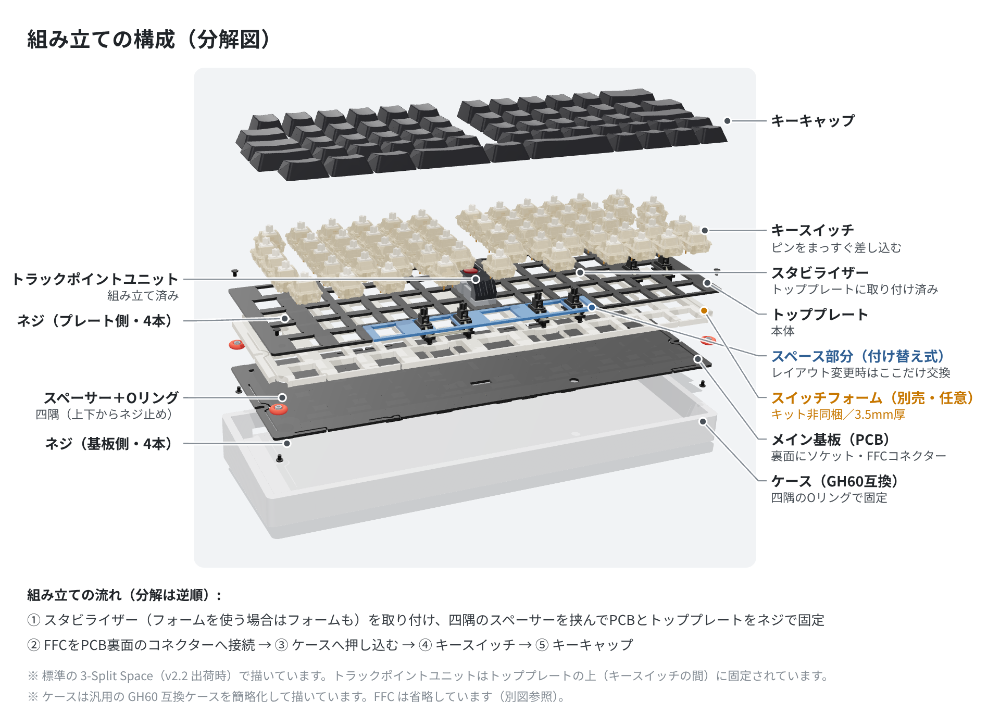
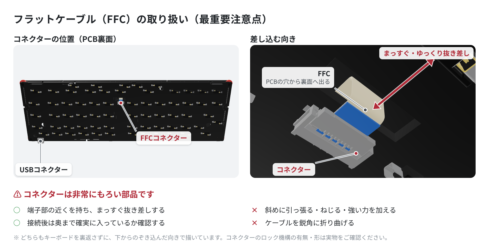
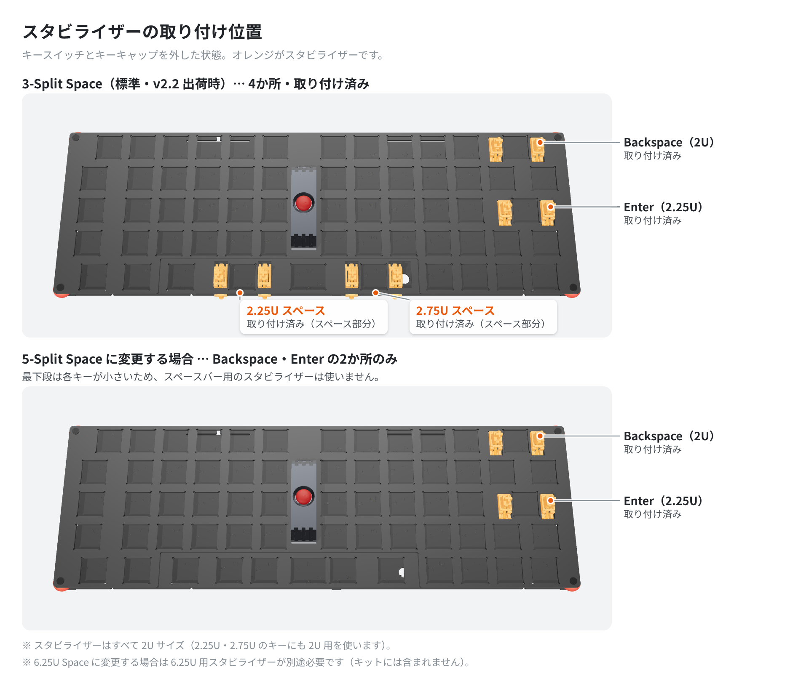
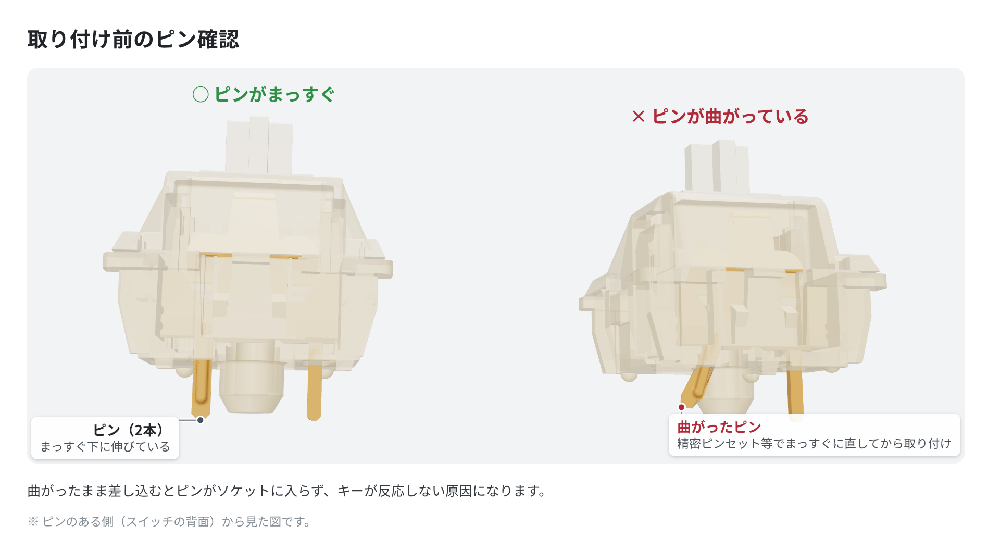
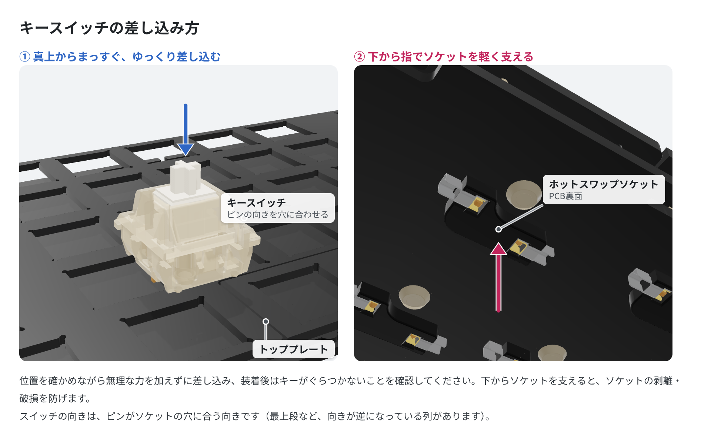
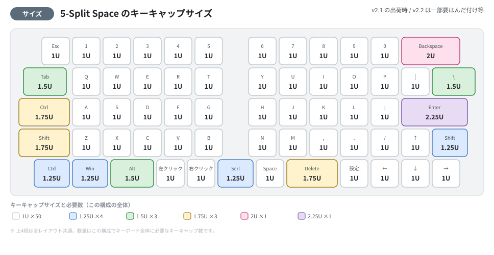
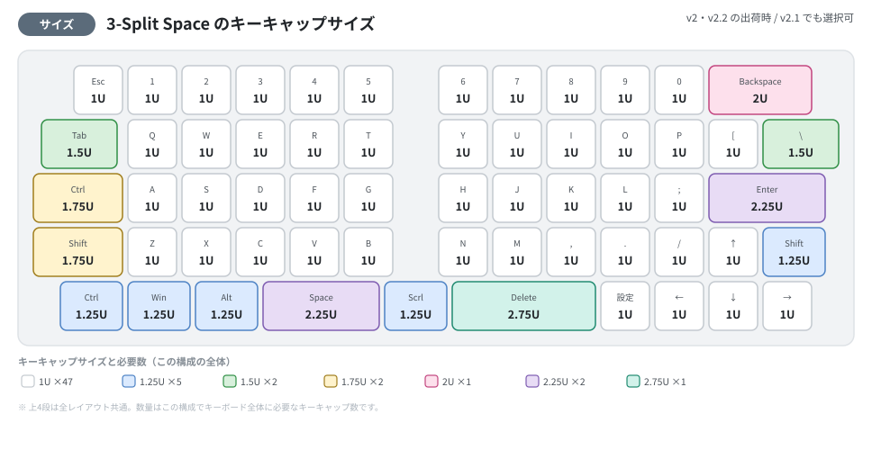
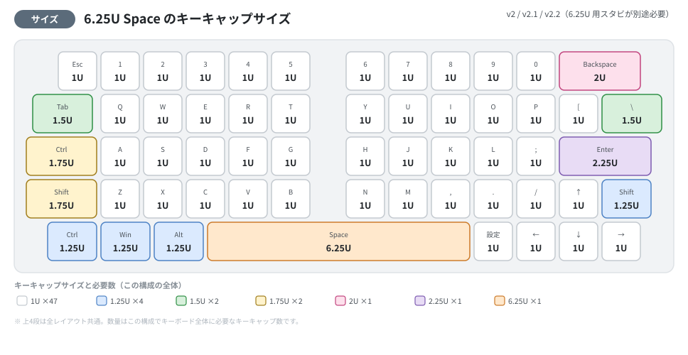
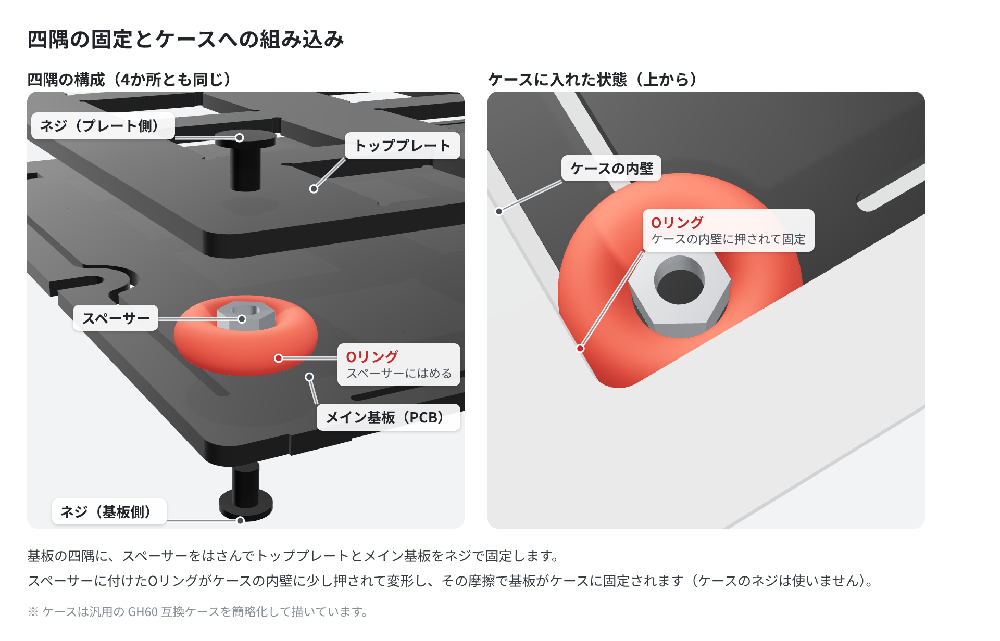

# OLSK60 v2 ビルドガイド

このドキュメントは、OLSK60 v2（格子配列60%キーボード）の組み立て手順をまとめたものです。  
キットの内容物や別途必要なパーツについては、[BOOTHの商品ページ](https://techmech.booth.pm/items/5896343)または[遊舎工房の商品ページ](https://shop.yushakobo.jp/products/11324)をご確認ください。

> **初心者の方へ:** セクション1「カスタマイズのための準備」はスタビライザー交換や別売フォームの追加など、カスタマイズ目的の作業です。  
> まずは組み立てたい場合は、[セクション2「キースイッチの取り付け」](#2-キースイッチの取り付け)から始めてください。

> **モデルについて:** 現在販売中のモデルは **v2.1** で、出荷時は **5-Split Space** レイアウトです。同梱のトッププレートで 3-Split Space／6.25U Space にも変更できます。旧モデル **v2** は 3-Split Space および 6.25U Space のみに対応しています。

---

## 1. カスタマイズのための準備（任意）

スイッチプレートの交換、別売フォームの追加、スタビライザー交換などのカスタマイズを行う場合に、このセクションの手順を実施してください。カスタマイズが不要な場合はスキップできます。

### 1.1 基本セットの分解手順

スイッチプレートの交換や別売フォームの追加、スタビライザー交換を行う場合は、以下の手順で基本セットを分解してください。全体の構成は次の図のとおりです（分解は組み立ての逆順です）。

トッププレートとメイン基板は、四隅の穴に入れた**スペーサー**をはさんで、上下から**ネジ**で固定されています。スペーサーには**Oリング**が付いていて、ケースに入れるとこのOリングがケースの内壁に押されて基板を固定します（[セクション4](#4-ケースへの組み込み)参照）。

1. ケースに組み込んでいる場合は、先に基板をケースから取り出します（[セクション4](#4-ケースへの組み込み)参照）。
2. 基板とスイッチプレートを分解する前に、トラックポイントとメイン基板を接続するフラットケーブル（FFC）を、**PCB裏面のコネクター**から外します。FFCはトッププレートとPCBの穴を通って裏面に回り込んでいます。

   

   > ⚠️ **注意:** フラットケーブルのコネクターは非常にもろいため、無理な力を加えず慎重に取り扱ってください。

3. トッププレート側（上面）の四隅のネジ（4本）を、付属のドライバーで外します。スペーサーとOリングはメイン基板側に残したままで構いません。
4. スイッチプレートと基板をゆっくりと分離します。トラックポイントユニットやケーブルが引っかからないよう注意してください。
5. 必要に応じて、スタビライザーやフォームを取り外します。
6. 必要なパーツの交換・貼り付け・取り付け作業を行ってください。
7. 作業が完了したら、基板とスイッチプレートを元通りに重ね、四隅のネジで固定します（[セクション1.6](#16-メイン基板とスイッチプレートの組み立て)参照）。

> ⚠️ **注意:** 組み立て済みのトラックポイントユニットを無理に外そうとすると破損の原因となります。交換や調整が必要な場合は十分ご注意ください。

### 1.2 トッププレート（スイッチプレート）の交換（レイアウト変更）

OLSK60 v2.1 は、出荷時に **5-Split Space（1U・1U・1.25U・1U・1.75U）** レイアウトのトッププレートが取り付けられています。最下段のスペースバー構成を変更したい場合は、同梱の **3-Split Space／6.25U Space 兼用トッププレート** に付け替えてください。

> **補足:** 旧モデル v2 は 3-Split Space（2.25U・1.25U・2.75U）および 6.25U Space のみに対応しており、5-Split Space 用トッププレートは使用できません。

<!-- 任意写真: images/build/03-top-plates.jpg（2枚のトッププレートの切り欠き比較。実物依存のため図解では代替しない） -->

1. [セクション1.1](#11-基本セットの分解手順)の手順で基本セットを分解します。
2. トッププレートを使用したいレイアウトのものに交換します。
3. レイアウトに合わせてスタビライザーの位置を調整します（[セクション1.3](#13-スタビライザーの交換)参照）。
4. 交換後は、**そのスペース列に合う出荷時キーマップ（プリセット）を書き込む**と、Space などの割り当てがそのまま使えます（`5split` / `3split`）。ファームウェアの機能はどちらも同じで、キー配置は Vial でいつでも変更できます。詳しくは[操作ガイドのレイアウトオプション](OLSK60_user_guide.md#スペースバーのレイアウトオプション)をご参照ください。

### 1.3 スタビライザーの交換

スタビライザーは、選択するスペースバーレイアウトに応じて取り付け位置が変わります。

**出荷時（v2.1・5-Split Space）に取り付け済みの位置:**
- バックスペースキー（2U）
- エンターキー（2.25U）

スタビライザーはいずれも 2U サイズです（2.25U・2.75U のキーにも 2U 用を使います）。

5-Split Space レイアウトでは、最下段の各キーが小さいためスペースバー用のスタビライザーは使用しません。同梱の予備スタビライザー（2U×2）は、他のレイアウトへ変更する際にご使用ください。

**他のレイアウトに変更する場合:**
- 3-Split Space … 2.25U と 2.75U の位置に 2U スタビライザーを追加（同梱の予備を使用）
- 6.25U Space … 6.25U 用スタビライザーが別途必要です（キットには含まれません）。**v3 には 6.25U 用のプリセットがありません**ので、いずれかを書き込んだうえで Vial で割り当ててください

> **補足:** 旧モデル v2 は、出荷時にバックスペース・エンターに加えて 2.25U・2.75U スペースバー用のスタビライザーも取り付けられています。6.25U Space に変更する場合は 6.25U 用スタビライザーを別途ご用意ください。

1. 必要な位置にスタビライザーを交換・取り付けます。
2. しっかりと固定されていることを確認してください。

### 1.4 スイッチフォームの設置（任意）

> ⚠️ **スイッチフォームはキットに含まれません。** 打鍵音や打鍵感を調整したい場合に、ユーザーご自身でご用意ください。取り付けは必須ではなく、フォームなしでも問題なく動作します。

1. **厚さ 3.5mm** のフォームをご用意ください。トッププレート下面とPCB上面の間隔が 3.5mm のため、この厚みがちょうど収まります。
2. 穴位置を合わせてPCB上に配置します（重ねる順序は[セクション1.1の分解図](#11-基本セットの分解手順)参照）。スイッチのピン・スタビライザー・トラックポイントユニットの取り付け部、四隅のスペーサー（Oリング）と干渉しないか確認してください。
3. FFCがトッププレートとPCBの穴を通るため、その経路をふさがないよう、必要に応じてフォームを切り欠いてください。

### 1.5 トラックポイントユニットの固定（必要に応じて）

トラックポイントユニットは**トッププレートの上、キースイッチとキースイッチの間**に設置されています（キット付属・組立済みです）。

1. ユニットがしっかりと固定されているか確認します。
2. ユニットが緩んでいる場合は、付属のネジやナットでしっかりと固定してください。
3. 必要に応じて動作確認を行ってください。

### 1.6 メイン基板とスイッチプレートの組み立て

1. スタビライザー（フォームを使う場合はフォームも）とトラックポイントユニットの取り付けが完了したら、メイン基板とスイッチプレートを、四隅のスペーサーの位置を合わせて重ねます。
2. トッププレート側から四隅のネジで固定します。締めすぎないように注意してください。
3. トラックポイントのFFCを、トッププレートとPCBの穴に通し、**PCB裏面のコネクター**へ再度接続します。奥まで確実に入っているか確認してください（取り扱いの注意点は[セクション1.1の図](#11-基本セットの分解手順)参照）。

   > ⚠️ **注意:** コネクターは非常にもろいため、無理な力を加えず慎重に取り扱ってください。

---

## 2. キースイッチの取り付け

1. 取り付ける前に、各キースイッチのピンが曲がっていないかよく確認してください。

   

2. スイッチをスイッチプレートとPCBにまっすぐゆっくりと差し込みます。位置を確かめながら、無理な力を加えずに差し込んでください。

   スイッチの向きは、**ピンがPCB裏面のソケットの穴に合う向き**です。最上段など一部の列はソケットの向きがほかの段と逆になっているので、スイッチも逆向き（180°回した向き）に差し込みます。

   

   > **ヒント:** 差し込み時は下側からソケットを軽く抑えながら作業すると、ソケットの破損防止になります。

3. すべてのキースイッチを差し込んだら、[Vial](https://get.vial.today/) に接続し、マトリクステスターで全てのキーが正しく動作するか一つずつ確認してください。

---

## 3. キーキャップの取り付け

1. 各キースイッチにキーキャップを取り付けます。
2. 配列・サイズに注意してください。出荷時の 5-Split Space レイアウトでは最下段の構成がほかのレイアウトと異なり、Alt が 1.5U、スペース部分が 1U・1U・1.25U・1U・1.75U になります（下のサイズガイド参照）。

### 3.1 キーキャップサイズガイド

各キーに必要なキーキャップのサイズ（1U＝標準1キー分の幅）を、スペースバーのレイアウトオプションごとに図示します。**上4段は全レイアウト共通で、最下段だけが異なります。** 各図の下部に、その構成でキーボード全体に必要なサイズ別の個数をまとめています。

> **補足:** 対応するスペースバーレイアウトはモデルによって異なります（v2.1 は 5-Split がデフォルト、v2 は 3-Split がデフォルト）。詳しくは[「1.2 トッププレートの交換」](#12-トッププレートスイッチプレートの交換レイアウト変更)および[操作ガイドのレイアウトオプション](OLSK60_user_guide.md#スペースバーのレイアウトオプション)をご参照ください。

**5-Split Space（v2.1 出荷時）**

**3-Split Space（v2 出荷時 / v2.1 でも選択可）**

**6.25U Space（v2 / v2.1）**

> **スタビライザーについて:** 2U 以上のキー（Backspace・Enter や、3-Split の 2.25U・2.75U、6.25U スペースバー）にはスタビライザーが必要です。取り付け位置は[「1.3 スタビライザーの交換」](#13-スタビライザーの交換)を参照してください。

---

## 4. ケースへの組み込み

OLSK60 v2 は**ケースにネジで固定しません**。四隅のスペーサーに付いたOリングがケースの内壁に少し押されて変形し、その摩擦で基板がケースに固定されます。

1. FFCがPCB裏面のコネクターに接続されていること、四隅のスペーサーにOリングが付いていることを確認します。
2. USBコネクターの位置をケースの開口に合わせ、組み立てたPCB＋プレート＋スイッチをGH60互換ケースへまっすぐ押し込みます。四隅が均等に入るように、少しずつ押し込んでください。ケースのネジは使いません。
3. 取り外すときは、四隅を均等に持ち上げるようにして、まっすぐ引き抜いてください。

---

## 5. ファームウェアの確認

OLSK60 v2は出荷時にファームウェアが書き込まれています。出荷時のファームウェアは 5-Split Space レイアウトに対応しています。**v3.0.0 の公開（2026年10月8日）より前に購入された場合は旧版（v2.x）が書き込まれているので、[firmware/README.md](../firmware/README.md) の手順で v3 に更新してください。**

> **補足:** v3 は Vial 専用です。どちらが書き込まれているかわからない場合も、更新して問題ありません（キーボードに保存された設定は初期化されます）。旧版の説明は [v2.0.3 時点の説明](https://github.com/techmech-keeb/OLSK60_v2/tree/v2.0.3) に残しています。

ファームウェアの更新が必要な場合は、[firmware/README.md](../firmware/README.md)をご参照ください。

1. USBケーブルでPCと接続します。
2. すべてのキー・トラックポイントが正常に動作するか確認してください。
3. v3 のキーマップのカスタマイズには [Vial](https://get.vial.today/) を使用します。キーボード定義はファームウェアに内蔵されているので、定義ファイルの読み込みは不要です。
4. v3 を書き込む場合は、**お使いのスペース列に合うプリセット**（`5split` / `3split`）を選ぶと、そのまま調整なしで使えます（機能はどちらも同じです）。詳しくは [firmware/README.md](../firmware/README.md) をご参照ください。

---

## 6. トラブルシューティング

| 症状 | 対処方法 |
|------|----------|
| キーが反応しない | スイッチを抜き差しし、ピンが曲がっていないか確認してください。改善しない場合はソケットの状態を確認してください |
| 複数キーが反応しない | 反応しないキーのスイッチを抜き差しし、ソケットが基板から浮いていないか確認してください。改善しない場合はお問い合わせください（フラットケーブルはトラックポイント専用で、キー入力には関係しません） |
| トラックポイントが動作しない | フラットケーブルの接続を確認してください。ケーブルを抜き差しして再起動もお試しください |
| キーボードがPCに認識されない | USBケーブルを抜き差し → 別のUSBポートを試す → 別のケーブルを試す |
| スタビライザーが引っかかる | スタビライザーが正しい位置にはまっているか、ワイヤーが外れていないか確認してください |
| 基板がケースの中でがたつく | 四隅のスペーサーすべてにOリングが付いているか確認してください |

---

## 7. 次のステップ

組み立てが完了したら、以下のドキュメントで使い方をご確認ください。

- [キーボード操作ガイド](OLSK60_user_guide.md) — レイヤー構成や各機能の使い方
- [マウス機能操作マニュアル](OLSK60_mouse_manual.md) — トラックポイントの速度調整

---

## 8. サポート

ご不明点があれば[BOOTHの商品ページ](https://techmech.booth.pm/items/5896343)または[GitHub Issue](https://github.com/techmech-keeb/OLSK60_v2/issues)にてご連絡ください。

---

以上で組み立ては完了です。お疲れ様でした！
